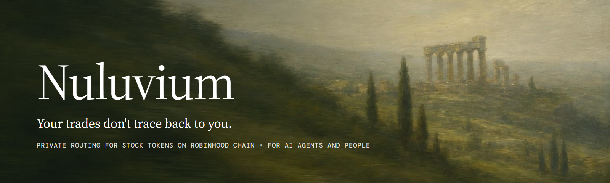

# Nuluvium

Private routing for stock tokens on Robinhood Chain, for AI agents and people. You keep a shielded
USDG balance in a [Privacy Pools](https://github.com/0xbow-io/privacy-pools-core) pool. Each order is
split into pieces of random size, sent at random times, and each piece is bought from a fresh address
through a relayer. Other readers of the chain can see the trades, but not that they are yours.

Privacy is from other readers of the chain, not from Robinhood. It grows with the crowd: with few
deposits, timing and amounts can still point a piece to its deposit. The numbers above are live.

**Testnet only, test tokens.** Deposits are capped at 1,000 USDG each until an independent audit.

## Use it

- **People:** the web app at [nuluvium.com](https://nuluvium.com/app). Log in with email or a wallet, deposit, and place an order in pieces.
- **AI agents:** an MCP server that runs on the agent's own machine, so its secret and its orders never leave it. Setup: [docs/mcp.md](https://github.com/nuluviumhq/nuluvium/blob/main/docs/mcp.md). An npm package (`@nuluvium/mcp`) is coming.

## Open source

| Repository | What |
|---|---|
| [**nuluvium**](https://github.com/nuluviumhq/nuluvium) | Everything that runs Nuluvium: the Router contract, the SDK, the MCP server for agents, the relayer, the approved-set provider (ASP), the stats Worker and the web app (Apache-2.0) |
| [approved-sets](https://github.com/nuluviumhq/approved-sets) | Every approved set the ASP has posted on chain, byte for byte, with a script to check them against the chain |

## Check our work

- [Stats](https://nuluvium.com/stats): crowd size, shielded balance, routed volume, the clean-funds check and the relayer, as totals over everyone. There are no per-wallet stats: we don't know which fresh addresses belong to whom.
- [Proof](https://nuluvium.com/app/proof): the contracts, the known limits and the latest pieces, read from the chain.
- [Approved sets](https://github.com/nuluviumhq/approved-sets): what the clean-funds check approved, what it did not and why.

<a href="https://nuluvium.com">Website</a> · <a href="https://nuluvium.com/docs">Docs</a> · <a href="https://nuluvium.com/stats">Stats</a> · issues go to each repository · not affiliated with Robinhood

